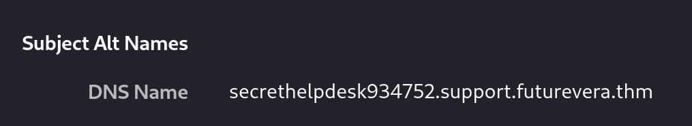

# TryHackMe Writeup - takeover
很重要!!記得將靶機ip與domain加到`/etc/hosts`檔案中
> sudo bash -c 'echo "{machine_ip} futurevera.thm" >> /etc/hosts'

## nmap看服務
得知該網站支持http與https協議
```
┌──(kali㉿kali)-[~/Desktop]
└─$ nmap 10.48.187.119 -F
Starting Nmap 7.98 ( https://nmap.org ) at 2026-02-05 01:04 -0500
Nmap scan report for futurevera.thm (10.48.187.119)
Host is up (0.032s latency).
Not shown: 97 filtered tcp ports (no-response)
PORT    STATE SERVICE
22/tcp  open  ssh
80/tcp  open  http
443/tcp open  https

Nmap done: 1 IP address (1 host up) scanned in 3.01 seconds
```
## fuff 炸子網域
使用ffuf對該網站的http與https協議進行子網域爆破
記得將結果加入到`/etc/hosts`檔案中!
```
┌──(kali㉿kali)-[~/Desktop]
└─$ ffuf -u http://10.48.191.191 -H "Host:FUZZ.futurevera.thm" -w /usr/share/seclists/Discovery/DNS/subdomains-top1million-5000.txt -fs 0 -s
portal

┌──(kali㉿kali)-[~/Desktop]
└─$ ffuf -u https://10.48.191.191 -H "Host:FUZZ.futurevera.thm" -w /usr/share/seclists/Discovery/DNS/subdomains-top1million-5000.txt -fs 4605 -s
support
blog
```
## 瀏覽子網域
在瀏覽到`support.futurevera.thm`時，會發現其憑證的`SAN`欄位中有一個`secrethelpdesk934752.support.futurevera.thm`的子網域


透過https及http分別瀏覽該子網域，會發現在http時網址列會變成flag

> https://flag{beea0d6edfcee06a59b83fb50ae81b2f}.s3-website-us-west-3.amazonaws.com/