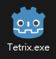
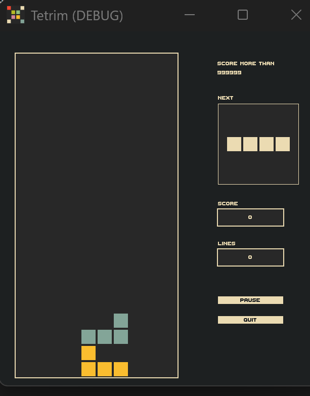
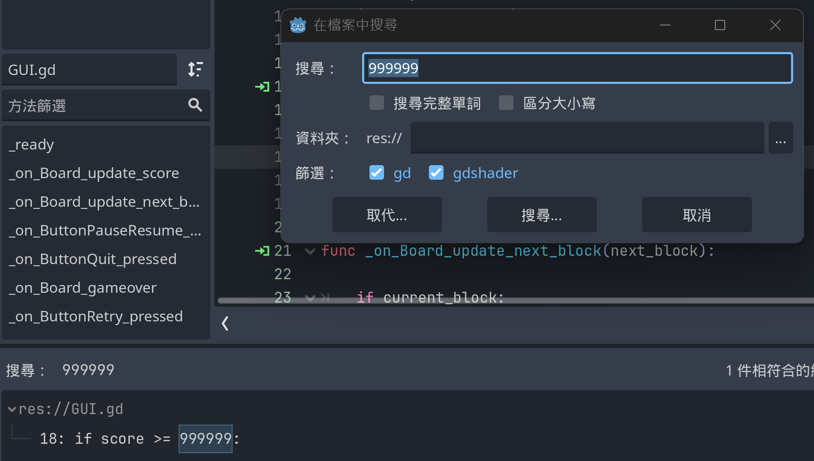
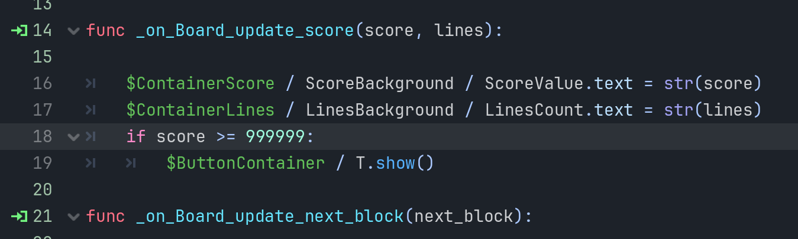
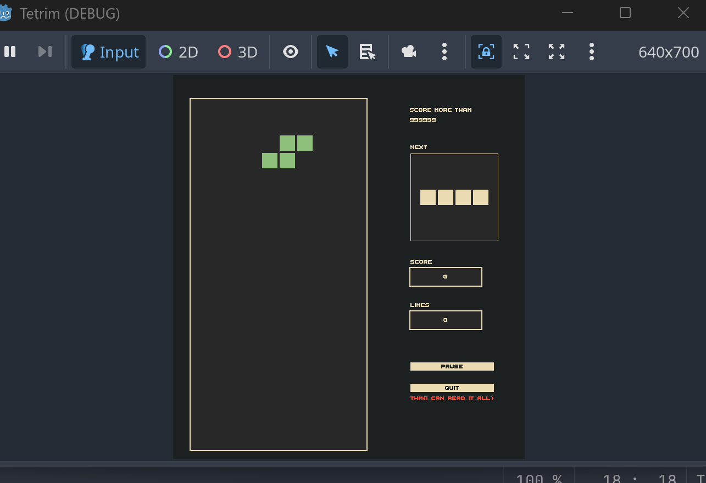

# TryHackMe Writeup - The Game
## 遊戲引擎辨識
觀察exe的圖示，會知道是使用`godot`遊戲引擎製作的


## 執行遊戲
是一個俄羅斯方塊遊戲，需要達到`999999`分


## 使用gdsdecomp工具來反編譯(重組)godot專案
使用該工具可將執行檔反編譯成godot專案

https://github.com/GDRETools/gdsdecomp

## 開godot專案
將反編譯後的專案開啟，透過搜尋功能能找到分數判斷腳本



我們便可將分數判斷修改成`0`分嘗試直接破關
```python
if score >= 0:
```

執行更新後的專案，可在欄位下方發現出現flag


ps.居然有工具能反編譯godot專案，真酷了